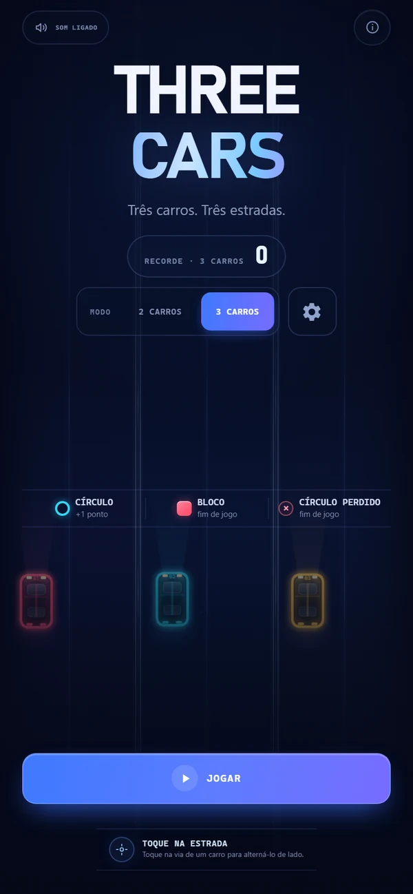
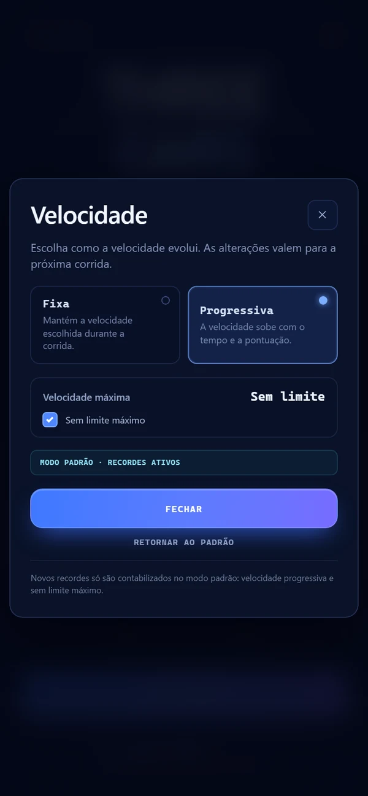
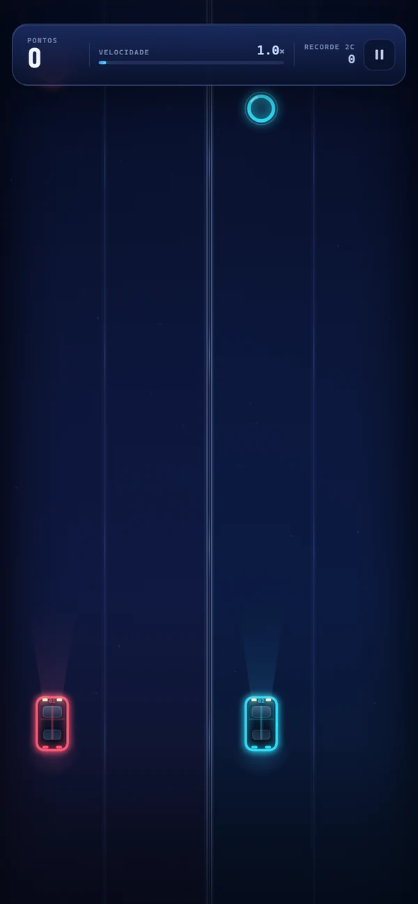
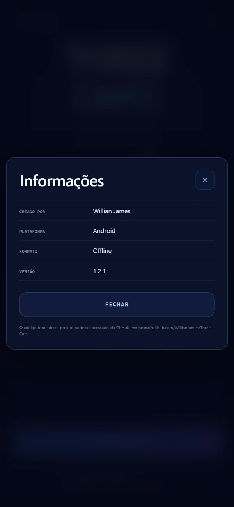

# Three Cars — Android

ATENÇÃO: Este projeto possui código gerado por IA

Versão Android do jogo, com controles por toque e tela cheia. O jogo funciona totalmente offline.

O APK instalável já está pronto:

```text
Versão Android/ThreeCars.apk
```









## Jogar

- **Toque na estrada de um carro** para alterná-lo entre as duas posições.
- Colete todos os círculos; cada um vale **+1 ponto**.
- Encostar em um bloco ou deixar um círculo passar encerra a corrida.
- Na tela inicial, escolha entre **2 carros** e **3 carros**.
- Cada modo tem seu próprio recorde, salvo no aparelho.
- A velocidade é definida nas configurações de velocidade.

## Novidades da versão 1.2.1

- **Controle de velocidade** no ícone de engrenagem ao lado do seletor de 2/3 carros.
- **Velocidade fixa**: o jogador escolhe um valor entre 1,0× e 4,0×.
- **Velocidade progressiva**: a velocidade sobe com o tempo e a pontuação, com limite máximo escolhido entre 1,5× e 4,0×.
- **Progressiva sem limite**: a velocidade sobe indefinidamente até a corrida terminar.
- O modo padrão é **progressiva + sem limite**. Os novos recordes só são contabilizados nesse modo.
- A janela mostra claramente quando o modo é **padrão** ou **personalizado** e oferece **RETORNAR AO PADRÃO**.
- A opção de som foi movida para o **canto superior esquerdo** da tela inicial.
- A frase "Colete todos. A velocidade aumenta com o tempo." foi removida do rodapé.
- O placar de recorde e o seletor de modo 2/3 carros estão maiores.
- A tela inicial foi rebalanceada: som no canto superior esquerdo, informações no canto superior direito e conteúdo distribuído sem o espaço exagerado no topo nem o rodapé colado.
- A legenda de regras foi elevada para não ficar sobre os carros decorativos.
- A troca de faixa inclina levemente o carro para o lado do movimento, deixando a animação mais natural.
- O ícone de engrenagem foi redesenhado no formato clássico de engrenagem.
- As fontes do menu de velocidade foram aumentadas para melhor leitura no celular.
- A tela Informações agora exibe o link do código-fonte no GitHub em uma observação menor.

## Recursos anteriores mantidos

- Tela cheia responsiva, sem moldura, com altura de mundo calculada pela proporção do aparelho.
- Troca de faixa suavizada em cerca de 0,2 s.
- Carros posicionados mais acima e sem indicadores de posição abaixo.
- Blocos preenchidos com a cor da estrada; círculos vazados.
- Tipografia maior nas HUDs, regras, botões e modais.
- Tela Informações objetiva, com autoria, plataforma, formato, versão e link do código-fonte.
- Ícone com os três carros — vermelho, âmbar e ciano.

## Instalação

1. Envie `Versão Android/ThreeCars.apk` para o aparelho Android.
2. Ao abrir o arquivo, permita a instalação por essa fonte, se solicitado.
3. Toque em **Instalar**.

A versão usa o mesmo certificado das versões anteriores, então pode ser instalada por cima. Caso o Android recuse a atualização, desinstale a versão antiga e instale esta (os recordes antigos serão perdidos).

Requisitos: **Android 7.0 (API 24) ou superior**. O APK é assinado e está na versão `1.2.1` (versionCode 6).

SHA-256 do APK:

```text
31B8DDF7CD6E2C539531CCB5831C2F11E7741CA606DE08DE0C5AC5A7CD6D0362
```

## Estrutura do projeto

```text
Versão Android/app/src/main/java/com/willianjss/threecars/MainActivity.java
Versão Android/app/src/main/assets/www/       jogo HTML/CSS/JS adaptado para toque
Versão Android/app/src/main/res/              ícones e textos do aplicativo
Versão Android/tools/merge_apk.py             empacotamento do classes.dex
Versão Android/build-apk.ps1                  build completo e assinatura
Versão Android/keystore/threecars-release.jks keystore usada na assinatura
Versão Android/ThreeCars.apk                  APK final
```

O aplicativo é uma Activity nativa em Java que exibe o jogo em um `WebView`. Todo o conteúdo é carregado localmente de `file:///android_asset/www/index.html`; o APK não pede permissão de internet e não depende de rede.

## Notas técnicas

- O canvas usa 540 unidades de largura e uma altura dinâmica calculada a partir da proporção real da tela. O `resizeCanvas` também reposiciona os elementos decorativos e a base dos carros quando a área muda.
- As fontes da interface usam `cqw` com limites, então crescem com a tela sem estourar em aparelhos pequenos.
- A área segura superior e inferior é considerada nos painéis para não ficar sob a câmera ou a barra de gestos.
- A troca de faixa interpola a posição visual com `easeOutCubic` em 0,2 s. A colisão continua usando a posição lógica da faixa.
- As preferências de velocidade ficam em `threecars.speed.v1`. O modo padrão é `{ mode: "progressive", max: null }`.
- `recordBestIfNeeded()` e o selo de novo recorde só são executados quando o modo é padrão: progressiva e sem limite.

## Build

Ferramentas necessárias:

- JDK 17
- Android SDK Platform 35
- Android Build Tools 35.0.0
- Python 3

Exemplo no Windows:

```powershell
Set-ExecutionPolicy -Scope Process -ExecutionPolicy Bypass
.\build-apk.ps1 -SdkRoot "C:\Android\Sdk" -JdkHome "C:\Program Files\Java\jdk-17" -Python "python"
```

O script copia o projeto para uma área de trabalho ASCII antes de chamar o `aapt2` — o `aapt2` desta versão não lê caminhos com caracteres acentuados. O APK final é copiado de volta para esta pasta.

O script compila todos os arquivos `.java`, passa **todos** os `.class` para o `d8` e confere com o `dexdump` se cada classe foi para o `classes.dex`. Isso evita o erro de classes internas ausentes que ocorreu na versão 1.0.1.
